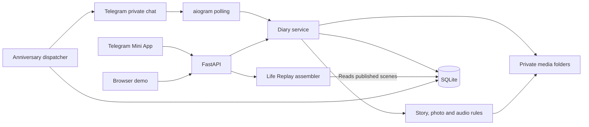

# Memory Experience architecture

A memory has one stable identifier from the first draft to the published day. Telegram and the web studio edit that same record. Publication stores a playback timeline alongside the original materials. This lets the table, note, player and cross-day editor interpret the same day consistently after a restart.

## Runtime

[main.py](main.py) validates configuration, chooses the storage directory, opens SQLite, applies migrations when configured, constructs the media, diary and narration services, seeds demo source days when appropriate and hands the application to Uvicorn. The [FastAPI lifespan](app/web/application.py) starts polling and the anniversary worker in private mode. Shutdown stops polling, cancels the worker and closes the notification bot session. Registering commands and the Mini App menu belongs to [polling](app/bot/polling.py). Deployment uses one process per bot token and persistent local storage.

## Capture, preview and publication

1. **Start or resume.** The chat handler takes the identity from the incoming private Telegram update. The web studio takes it from its authenticated API session. Both ask `Diary.draft` for the owner's unfinished row. A partial unique index enforces one unpublished row per owner.
2. **Collect materials.** The bot accepts text, album members, captions, a user-shared location and a song supplied as a link or file. Album replies are coordinated in memory while the inputs themselves are persisted. The browser offers a four-step capture flow with photo ordering. A draft edit matches its owner, ID and revision. A competing edit must reload the current version.
3. **Build a candidate.** The preview endpoint reads the materials, validates the selected frame and editing choices, assembles the scene and stores its token and base revision in `scene_preview`. A candidate for a music change can reference a newly uploaded file while the published day still plays its original soundtrack.
4. **Confirm.** `Diary.commit_preview` checks the token and revision in the database update, promotes the candidate scene, details, track and narration, increments the revision and sets the first publication timestamp. A repeat confirmation of the published token returns the saved day. Automatic anniversary enrollment, when selected, is part of first publication. The private application then attempts the Telegram confirmation with a link to that exact day.
5. **Revisit or edit.** The archive lists published days. Cover choices and corrected mood tags have their own fields. Studio edits to shots go through preview and confirm. Changing an event date can reschedule an active anniversary. Deletion requires ownership and the current day revision. A source used in a saved film is protected. After successful database deletion the application removes the day directory.

The bot's entry, material, draft and collection handlers live in [app/bot/handlers](app/bot/handlers/). The publication rules and candidate lifecycle live in [Diary](app/services/diary.py). The demo seeder also has a direct save path through the same scene builder. Filesystem writes and database transactions have separate commit points. An interrupted operation can leave unreferenced files on disk.

## Persistent model

| Table | Contents and invariant |
| --- | --- |
| `days` | UUID, owner, event date, creation and publication timestamps, revision, draft step, source story, ordered photo references, track and optional details. JSON columns hold the published scene, comparison, candidate versions, cover choices and narration. Favorites and corrected mood tags support archive queries. |
| `user_preferences` | One row per owner for the timezone, anniversary opt-in, title visibility in notifications and account-wide interface theme. |
| `anniversaries` | Next scheduled year and local clock keyed by day. The service resolves ownership and the event date through the day. |
| `anniversary_deliveries` | One delivery record per day and anniversary year, with status and optional retry time. |
| `life_films` | Owner and a JSON snapshot of the assembled chapters, shot times, captions, music references and edit revision. |
| `film_sources` | Composite primary key of film and day. Deleting a film cascades to its source links. Deleting a referenced day is restricted. |

SQLite connections enable foreign keys, WAL and a busy timeout. The storage layer writes bytes via a temporary file and rename under `media/<day-id>/`. The same directory can contain originals, replacement audio, voice previews and mixes. Display titles can change independently of asset paths. Photos are decoded and verified before storage. The limit is ten still JPEG, PNG or WebP files at 10 MiB and 32 megapixels each. The audio limit is 20 MiB. Authorized photo previews are resized to fit 768 × 768 and cached in process. See [models](app/infrastructure/db/models.py), [database setup](app/infrastructure/db/database.py) and [media storage](app/infrastructure/media/).

The migration chain adds the initial day model (0001), timezone preferences (0002), covers (0003), preview candidates (0004), narration (0005), anniversaries and archive marks (0006), Life Replay (0007), film-source protection (0008) and interface themes (0009). The latest migration gives existing preference rows the paper default. Earlier saved scenes are read without bulk regeneration. [Migration history](migrations/versions/)

## Day Replay and art direction

| Input or choice | Processing and saved result |
| --- | --- |
| Story, selected phrase, photo captions | The local story rules extract an opening, a possible turn and a closing line. A chosen detail takes precedence over an inferred ending. An explicit photo caption can supply the line for its own frame. The complete original story stays available. |
| Photographs | The palette service samples small thumbnails, quantizes colors and weighs perceptual similarity, coverage and local color boundaries. The main image influences the cover field. The accent may come from a much smaller region. The result includes foreground, shadow, accent and a fallback for nearly neutral pictures. |
| Accessible audio | Mutagen reads supported metadata. FFmpeg decodes up to 75 seconds of mono audio at 8 kHz, with a six-second decoder timeout. Local code computes an energy envelope, possible onsets, energy changes and a pulse estimate when confidence permits. |
| Timing | The editor chooses an excerpt or uses a bounded user cue, allocates readable shot durations and shifts eligible cuts near measured accents. It records the offset, duration, aligned cut times and whether the timing basis is measured or descriptive. A linked song opens externally. Its chosen character still changes shot length, transitions and camera movement. |
| Mood and composition | Text-derived or confirmed tags can overlap across five emotional collections. Photo warmth, musical energy and narrative space have distinct roles. A reflective line can reduce camera travel while the score maintains quick cuts. The saved interpretation includes an artistic family, camera and dissolve parameters, typography and reasons. |
| Note layout | The diary compares the new work to up to four recent scenes of the same owner. For similar materials it penalizes repeating the same print layout. Photo proportions break ties. A compatible previously saved layout is reused on regeneration. |
| Voice | Optional local Piper models synthesize the full story and up to three shorter lines. The service measures speech lengths, schedules the lines and uses FFmpeg to lower uploaded music around the voice in a separately generated mix. Voice choice and rates of 0.85×, 1× and 1.15× can be previewed before saving. |

A version 2 day scene contains a title, cover, palette, sticker, treatment, track, soundtrack excerpt and signals, emotion parameters and ordered frames. Each frame identifies its asset and records start, duration, crop, camera motion, transition and caption interval. The player uses the audio playback position when local sound is active, and elapsed visual time otherwise. Pause, seeking and replay address this saved timeline. The application produces interactive playback. An MP4 renderer and a streaming catalogue are outside the implemented pipeline.

The main entry is [scene assembly](app/services/scene.py). Individual decisions are in [story](app/services/story.py), [palette](app/services/palette.py), [audio analysis](app/infrastructure/audio/analysis.py), [timing](app/services/timing.py), [emotion](app/services/emotion.py), [studio](app/services/studio.py) and [narration](app/services/narration.py).

## Life Replay

The studio can shortlist days in a period or receive a selection from the archive. The server checks ownership of two to twenty distinct published days. It orders them manually, chronologically or by the shared energy parameter. Each chapter uses the opening and final frames where time allows, or the final frame alone. A supplied chapter caption overrides the default ending. Duration is a target bounded by the source material and readability. The assembler can move a chapter's internal cut toward a suitable stored audio cue.

The score can use uploaded audio per chapter, one selected uploaded track across chapters, or silence. Preview returns a playable film definition. Save writes its snapshot and source links in one transaction. Editing an existing film checks its edit revision. The browser plays the saved definition using protected source URLs. [Assembler](app/services/life.py) · [Film API](app/web/routes/films.py) · [Studio](web/scripts/life.js) · [Player](web/scripts/life-player.js)

## API and identity

| Module | Representative routes and responsibilities |
| --- | --- |
| [diary](app/web/routes/diary.py) | Mode and Telegram session, day list and folders, authorized media, cover, pin, scene preview/confirm and voice preview/confirm. |
| [capture](app/web/routes/capture.py) | `POST /api/capture` opens the current draft. Fields, upload and removal routes act on its ID and check its revision. |
| [library](app/web/routes/library.py) and [remix](app/web/routes/remix.py) | Published metadata and deletion, plus proposals for replacing a soundtrack with a link or file. |
| [collection](app/web/routes/collection.py) | Archive context, favorite and mood marks, appearance reads/writes and reminder settings. |
| [films](app/web/routes/films.py) | `POST /api/films/preview` and `/api/films/save`, plus listing, reopening and deleting saved films. |
| [demo](app/web/routes/demo.py) | `POST /api/demo/start` creates or resumes the browser's fictional library. |

Private sessions verify Telegram's HMAC signature and launch timestamp (ten-minute freshness window) and issue an eight-hour signed credential. JSON requests use a bearer token. A path-scoped HttpOnly cookie supports native media loading, with authenticated blob fetching when the cookie probe fails. Media reads check the owner, day and referenced asset before opening the file. Only scripts, styles, artwork and fonts are mounted as static directories. [Authentication](app/web/auth.py) · [Browser client](web/scripts/client.js)

The demo has a separate database and media root. A random cookie identifies an isolated browser library. Initial metadata is copied from the six fictional days, with hard links to the seed media on the same filesystem. Personal text, images and music stay out of the demo. The seed and per-browser copy are separate operations. [Seed inputs](demo/seed.py) · [Demo initialization](app/web/routes/demo.py)

## Browser and navigation

The HTML shell loads native ES modules. [experience.js](web/scripts/experience.js) establishes the session, checks media support, loads appearance and dispatches views. The home opens the Memory Table. A print links to `/?day=<id>`. The note opens Day Replay, retains access to originals and can open a cover sheet. The app handles the Telegram back button, browser history and safe-area insets. Additional screens are loaded through [screens.js](web/scripts/screens.js).

| View | Implementation |
| --- | --- |
| Table and note | [memory-table.js](web/scripts/memory-table.js) builds reusable prints. [folder.js](web/scripts/folder.js) adds the story, gallery, music and actions. [motion.js](web/scripts/motion.js) handles shared-photo transitions. |
| Archive, calendar and feed | [screens.js](web/scripts/screens.js) and [collection.js](web/scripts/collection.js) handle collections, query, date, favorites, mood filters and film selection. [memory-shelf.js](web/scripts/memory-shelf.js) implements the secondary photographic feed. |
| Capture, cover and montage | [capture.js](web/scripts/capture.js), [sheet.js](web/scripts/sheet.js), [scene-tools.js](web/scripts/scene-tools.js) and [studio-controls.js](web/scripts/studio-controls.js) edit the owner's inputs and candidates. |
| Players | [player.js](web/scripts/player.js) presents a single day. [life-player.js](web/scripts/life-player.js) plays assembled chapters. |
| Appearance | [theme.js](web/scripts/theme.js) persists the account's paper/neon selection. [themes.css](web/styles/themes.css) styles the interface. [table.css](web/styles/table.css) defines the physical print composition. |

**Where a choice lives matters.** A theme follows the account. A pinned light and table slot order live in owner-scoped browser storage. Search and return position use browser navigation state. A cover override belongs to one day. Camera motion and caption timing belong to the saved scene. Trying another interface theme therefore requires no scene regeneration.

## Scheduled work

The private reminder dispatcher polls for due anniversaries. The default local clock is 19:00. February 29 is observed on February 28 in a common year. A twenty-four-hour catch-up window limits late delivery. Before contacting Telegram the worker claims the occurrence in SQLite. A definite rate limit can schedule a retry. An uncertain outcome is recorded to suppress duplicate delivery. The user can opt into automatic enrollment of future days and separately allow titles in notifications. [Scheduling rules](app/services/anniversaries.py) · [Dispatcher](app/bot/anniversaries.py)

See the [verification record](IMPLEMENTATION_PROGRESS.md) for exercised paths and device checks that still need a real Telegram client.
