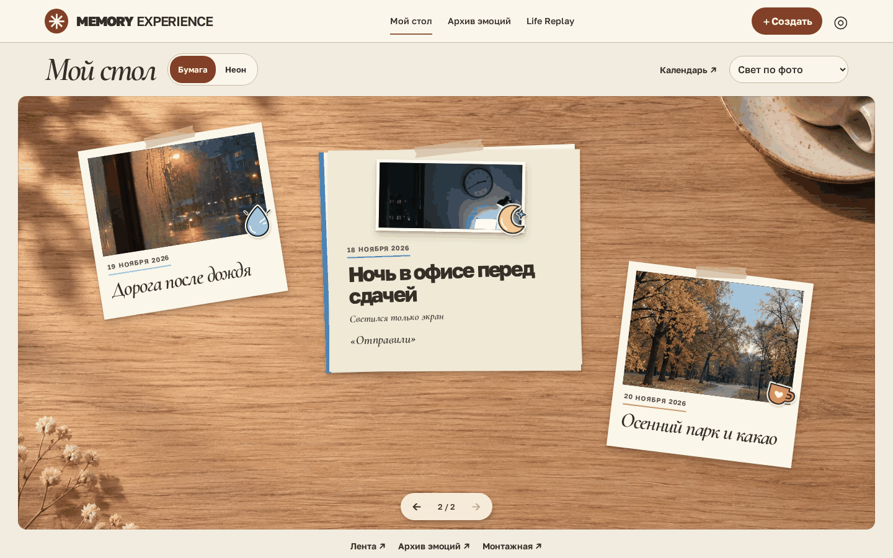
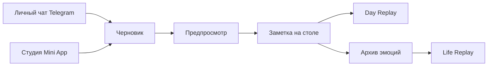
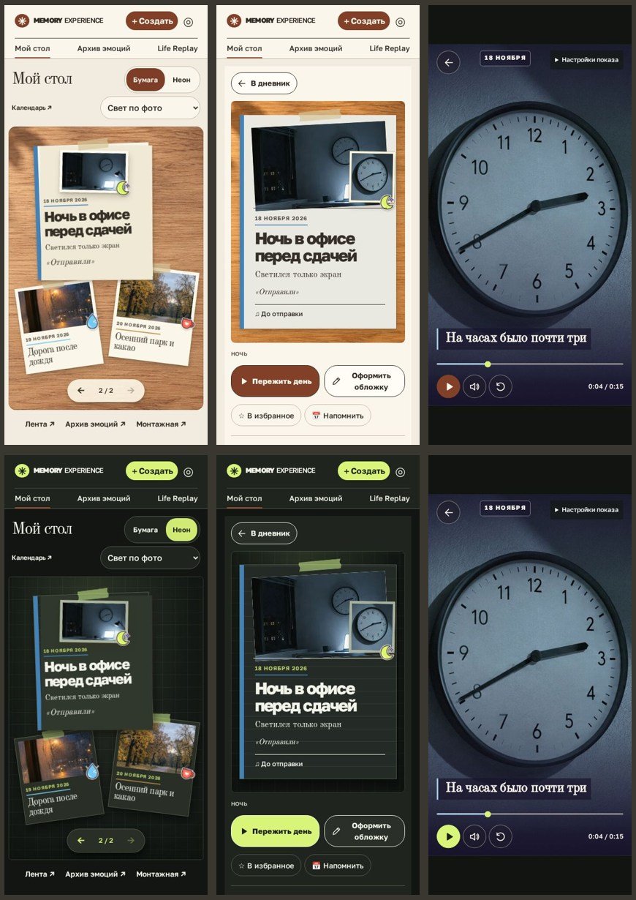

# После дня
### MEMORY EXPERIENCE · GENESIS ARTTECH HACKATHON

**Вернитесь к тому, как ощущался день.**

Личный кинодневник в Telegram. Из рассказа, фотографий и песни он собирает сцену, в которой хочется задержаться.

---

## 01 / Идея

В галерее остаётся фотография заката. В переписке остаётся сообщение о том, о чём вы говорили. Песня, которую тогда включили, живёт в плеере. Через время легче вспомнить, **где** всё было, чем восстановить ощущение самого момента.

«После дня» собирает эти материалы в одном месте и находит для них форму. В заметке можно перечитать исходный рассказ и открыть оригиналы. В **Day Replay** те же материалы разворачиваются во времени: важная фраза появляется в нужном кадре, музыка задаёт склейки, а финал оставляет место для паузы. Из нескольких дней можно собрать **Life Replay**, фильм с главами из собственного дневника.

В центре продукта три вопроса. **Какая деталь осталась с вами? Как она выглядела? С каким ритмом стоит к ней вернуться?** На них отвечают текст, фотографии и музыка.

## 02 / От сообщения до воспоминания

### Что умеет бот

| Возможность | Как это работает |
| --- | --- |
| **Главное меню** | `/start` открывает «Записать день», «Дневник», «Найти воспоминание», «Избранное», «Life Replay» и «Напоминания». Если остался черновик, бот предлагает его продолжить. Записи и подборки открываются в Mini App. |
| **Запись дня** | Бот принимает рассказ, одно фото или целый альбом, ссылку на песню либо аудиофайл. Можно отправить фото документом или прикрепить голосовое сообщение как звук. Подпись к фото сохраняется, а при пустом рассказе её можно использовать как основной текст. |
| **Работа с черновиком** | Материалы сохраняются по мере отправки. Бот показывает, что уже есть и чего ещё не хватает. Распознаваемые материалы можно присылать заранее. Для замены уже записанного текста или песни бот предлагает открыть нужный пункт редактирования. |
| **Исправления и отмена** | Через «Изменить» можно заменить рассказ или песню, добавить фотографии, убрать снимок по номеру и поправить звучание. Удаление черновика запрашивает подтверждение. `/cancel` открывает тот же путь. |
| **Дата и обстоятельства** | Можно выбрать сегодня, вчера или ввести другую дату. Время можно указать как часы или словами, например «поздний вечер». Бот принимает название места, точку или место из Telegram, а также подпись к точке. В деталях есть готовые варианты погоды, произвольное описание погоды и настроения. |
| **Акцент и музыка** | Можно указать главную деталь, выбрать главный кадр и задать секунду начала загруженного трека. Если нужно уточнить звучание, бот предлагает «Мягкий», «Пульсирующий», «Резкий» и «Постепенно нарастает». Дополнительные поля можно пропустить, изменить или очистить. |
| **Предпросмотр и сохранение** | «Собрать воспоминание» открывает черновик в Mini App. После публикации бот присылает название и кнопку «Открыть день», ведущую в конкретную заметку. Из сообщения можно вернуться в дневник или включить годовщину. |
| **Поиск** | «Найти воспоминание» и `/find` принимают слово, место, дату или несколько настроений через запятую. Бот показывает до пяти совпадений с датой и ссылкой на запись. `/archive` открывает архив. |
| **Годовщины** | «Напомнить через год» ставит напоминание на ближайшую будущую годовщину. Бот показывает дату и местное время и предлагает отменить напоминание. `/timezone` меняет часовой пояс. |
| **Подсказки и оформление** | Группы фотографий обрабатываются как альбом. При неподходящем формате, слишком большом файле или неудачной загрузке бот предлагает следующий шаг. Для приветствия, сборки, первого сохранения и годовщины можно настроить Telegram-стикеры. |

Для записи достаточно рассказа, хотя бы одного снимка и музыки. Доступный лимит — до десяти фотографий JPEG, PNG или WebP и аудиофайл до 20 МиБ. Если пользователь делится координатами, они остаются в личной записи, а на обложке отображается только подпись места.

### Что открывается в Mini App

- **«Мой стол».** Архив начинается с предметной композиции. На одном развороте размещается до трёх заметок и фотографических отпечатков. Развороты листаются стрелками и свайпом. Можно менять расположение предметов и закреплять освещение на текущем устройстве. Когда есть совпадение по дате, появляется возможность вернуться к прежнему дню.
- **Заметка.** Обложка, дата, оригинальный рассказ, галерея и аудио собраны вместе. Можно добавить день в избранное, включить напоминание, открыть ссылку на песню, послушать запись голосом, посмотреть объяснение художественных решений или запустить «Пережить день». Опубликованный день можно удалить с подтверждением.
- **Создание и монтаж.** Встроенная студия позволяет записать день без переписки с ботом. В редакторе можно менять обложку, цвет и стикер, выбирать главный кадр, менять порядок фото, обработку и движение камеры, задавать длительность, править подписи и начало музыки. Кандидат можно посмотреть до подтверждения. Опубликованная версия остаётся доступной во время подготовки новой.
- **Day Replay.** Вертикальная сцена с сохранёнными кадрами, подписями и музыкой. У плеера есть пауза, перемотка, управление звуком и повтор. Можно по очереди просмотреть версии под основной и второй песней.
- **«Архив эмоций».** Поиск по словам рассказа, названию, месту и дате, фильтры по месяцу, настроениям и избранному. Есть календарный вид и сортировка от новых к старым или наоборот. Метки можно исправлять и сочетать. Один день может попасть в несколько коллекций.
- **Life Replay.** Можно подобрать записи за период автоматически или вручную выбрать от двух до двадцати сохранённых дней. Главы располагаются в выбранном, хронологическом порядке или по энергии. Можно изменить подписи, ориентир длительности и музыкальный режим: свой загруженный трек на главу, одна доступная дорожка на фильм или тишина. Фильм можно посмотреть, сохранить, открыть снова, отредактировать и удалить.
- **Настройки возврата.** Можно посмотреть ближайшие годовщины, изменить время отдельного напоминания, отключить его или включить напоминания для новых записей. Время по умолчанию — 19:00 в часовом поясе пользователя. Название в Telegram-уведомлении показывается по желанию. Для 29 февраля в невисокосный год используется 28 февраля.

## 03 / Художественная система

**Стол → заметка → фильм.** Издалека день узнаётся по фотографии, цвету и расположению. Вблизи открываются дата и фрагмент фразы. В плеере внимание переходит к последовательности кадров, паузам и голосу. У этих трёх масштабов разные задачи.

**Две темы одной коллекции.** «Бумага» строится вокруг деревянной поверхности, тёплых отпечатков и фотографий под лентой. «Неон» переносит те же личные предметы на тёмную монтажную поверхность с лаймовыми акцентами. Тема привязана к аккаунту, оформление конкретной заметки — к самой записи. Переключение темы сохраняет пользовательский монтаж.

**Композиция зависит от материала.** Журнальный разворот даёт место тексту. Кинематографичный отпечаток выделяет один сильный кадр. Коллаж сближает детали. Геометрическая композиция задаёт более собранный ритм. Мягкая живописная обработка оставляет больше пространства свету. При выборе раскладки учитываются форма снимков и недавние заметки, чтобы стол сохранял разнообразие.

**Типографика и знаки.** Курсив Cormorant Garamond задаёт интонацию личной записи, Golos Text обеспечивает читаемость интерфейса. Восемь оригинальных стикеров образуют одну семью. Капля, чашка, билет, луна, окно, наушники, камера и искра помогают вспомнить конкретную деталь. Стикер можно заменить или убрать.

В художественных референсах важны приёмы. У *Illuminance* Ринко Каваути — смена масштаба и внимание к малому. У *Apartamento* — повседневная среда и уверенная типографика. У Йозефа Мюллера-Брокмана — сетка и ритм повторяющихся форм. [Референсы и происхождение материалов](docs/product.md)

## 04 / Почему один день выглядит иначе, чем другой

| Вход | Решение | Что можно заметить |
| --- | --- | --- |
| **Рассказ** | Локальные правила извлекают заголовок и короткие фразы, ищут начало, возможный поворот и финальную деталь. Явно выбранная пользователем деталь имеет приоритет. | Строка «Отправили» получает отдельный момент, на котором движение может остановиться. |
| **Фото** | Алгоритм анализирует уменьшенные копии, учитывает цвет, контраст, относительную площадь и соседство оттенков. Небольшое цветовое пятно может стать акцентом. | Тёплый отблеск влияет на заметку, даже если большую часть кадра занимают холодные тени. Оригиналы доступны в галерее. |
| **Загруженная песня** | Локальный анализ ищет изменения энергии и временные звуковые акценты. Сборщик выбирает отрезок и подвигает подходящие склейки, сохраняя время на чтение подписи. | Одна и та же фотография задерживается разное время в двух монтажах. |
| **Ссылка или слабый сигнал** | Для ссылки и при неуверенном анализе используется характер трека. Ссылка открывается отдельно через «Открыть песню». | Песня всё равно меняет длительность кадров, движение и характер переходов. Покадровая синхронизация опирается на доступный аудиофайл. |
| **Пользовательская правка** | Настроения можно подтвердить и сочетать, главную фотографию и фразу можно указать явно. | Один день может отражать и напряжение, и облегчение. Холодный цвет при этом может сохраниться, а нервный ритм смениться неподвижным финалом. |
| **Голос** | При установленных моделях Piper можно выбрать голос и скорость 0,85×, 1× или 1,15×, прослушать пробу и сохранить. Длительность речевых фрагментов учитывается в сцене. | В папке можно послушать рассказ целиком. В фильме звучат короткие реплики, а загруженная музыка приглушается вокруг голоса. |

**Сравнение монтажа — способ проверить вклад музыки.** При добавлении второй песни сохраняются фотографии, их порядок, подписи и кадрирование. Пересчитывается таймлайн. На примере «Осенний парк и какао» доступна ещё и версия с равномерными интервалами на исходном фрагменте. Так можно отдельно услышать влияние песни и увидеть влияние расчёта склеек.

**Настроение складывается из нескольких признаков.** В коллекциях «Светлые», «Тёплые», «Напряжённые», «Смешные» и «Грустные» используются подсказки по словам и пользовательские метки. При художественной сборке цвет, скорость склеек и амплитуда движения решаются отдельно. В «Письме на пустой платформе» быстрый пульс может соседствовать с медленным движением камеры и большим свободным пространством вокруг кадра.

## 05 / Шесть встроенных примеров

Это вымышленные записи браузерной библиотеки. Они проходят через тот же сборщик, что и личные дни. Для части примеров авторы задали исходные художественные акценты.

| Запись | Деталь, за которой стоит следить |
| --- | --- |
| **Осенний парк и какао** | От прохладной аллеи к тёплой чашке. Фраза «Долго разговаривали» становится финальной опорой. Есть вторая песня и ровный монтаж. |
| **Дорога после дождя** | От запотевшего окна к отражению в луже. Последняя фраза — «Фонарь дрожал в луже». |
| **Смех на кухне** | Поздний ужин, подгоревший тост и смех. Живой трек и тёплая композиция подчёркивают смену интонации. |
| **Ночь в офисе перед сдачей** | Свет экрана, час на часах и резкий ритм сходятся к простой фразе «Отправили». |
| **Письмо на пустой платформе** | Пустая платформа и закрытый конверт. Быстрый ритм соседствует с тихим ожиданием. |
| **Первый свет над городом** | Свет сначала заметен на стене, потом доходит до крыш. Дорожка постепенно набирает энергию. |

## 06 / Инженерный вклад и границы продукта

Бот на **aiogram** и Mini App на **HTML, CSS и JavaScript** используют одно ядро дневника на **FastAPI**. **SQLite**, **SQLAlchemy** и **Alembic** хранят черновики, настройки, опубликованные таймлайны и фильмы. **Pillow**, **Mutagen**, **FFmpeg** и опциональный **Piper** используются для изображений, анализа аудио и озвучки. Запуск бота и веб-приложения объединён в `python main.py`.

Оригиналы лежат отдельно от публичной статики. Сервер проверяет подпись и срок действия данных запуска Telegram и ограничивает запись, чтение и выдачу файлов владельцем. При подтверждении монтажа проверяются версия черновика и токен предпросмотра. Сохранённая сцена содержит порядок кадров, интервалы, кадрирование, движения, подписи и звуковые параметры. После перезапуска браузер воспроизводит сохранённое решение. Фильм хранит собственный таймлайн и ссылки на исходные дни. Удаление используемого дня защищено, пока на него ссылается сохранённый фильм.

Годовщины хранятся в базе. Отдельный журнал доставок учитывает каждое ежегодное событие, а окно поздней отправки ограничено сутками. Для запуска личного режима нужны токен Telegram и публичный HTTPS-адрес. Браузерная библиотека с вымышленными примерами работает отдельно от личных данных.

**Вклад команды** — совместный черновик бота и Mini App, правила интерпретации рассказа, выделение цвета и звуковых акцентов, сборщик и сравнение монтажей, плееры и их синхронизация, дизайн стола и заметок, стикеры, озвучка, сборка фильма из нескольких дней и возврат через годовщины. Встроенные фотографии вымышленных дней и поверхность стола созданы с помощью ImageGen. Инструментальные дорожки примеров синтезирует генератор проекта. При сборке личной записи используются локальные правила и материалы пользователя. [Архитектура](ARCHITECTURE.md) · [Источники и лицензии материалов](docs/product.md)

**Текущие ограничения.** Приложение воспроизводит фильмы как интерактивные сцены. Экспорт из Mini App в MP4 и поиск песен по каталогу отсутствуют. Для встроенного звучания песни нужен доступный аудиофайл, а для локального голоса — настроенные модели Piper.

---

**После дня. Чтобы одна деталь снова вернула весь вечер.**
