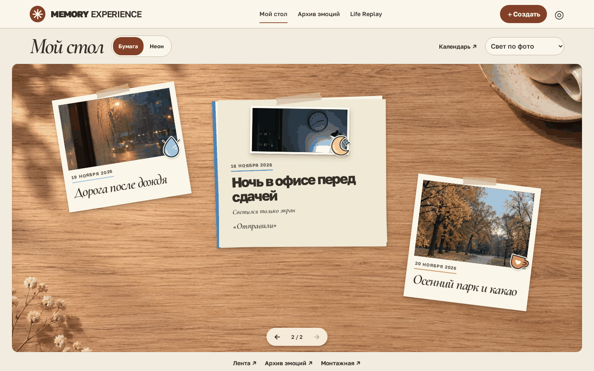
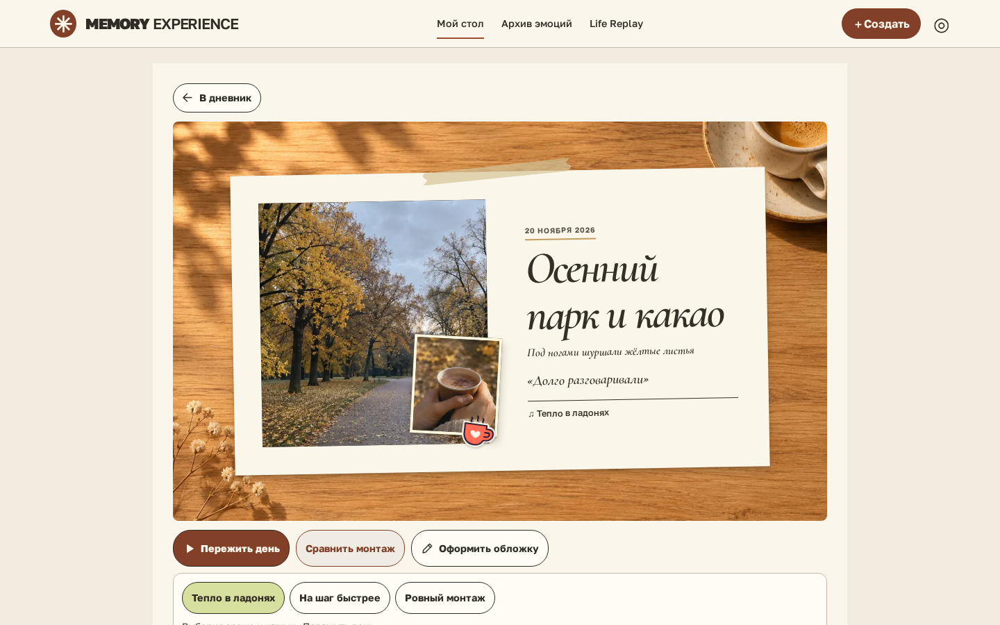
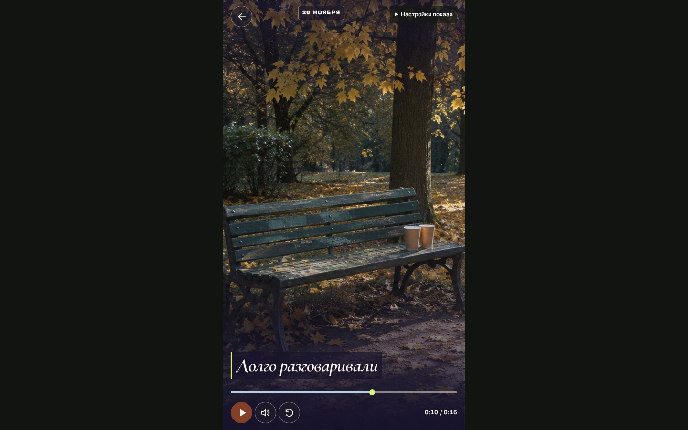
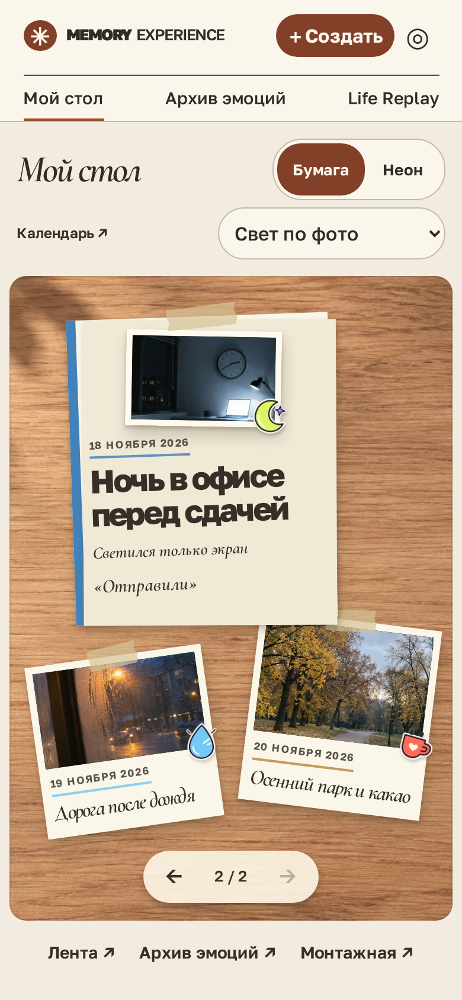
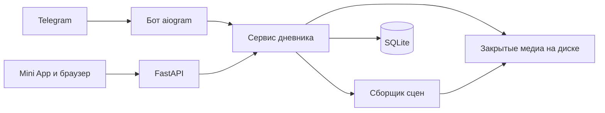

<div align="center">

# После дня · Memory Experience

Личный кинодневник в Telegram для тех, кто хочет заново пережить день по своим словам, фотографиям и музыке. Проект команды Titans. Genesis HACKATHON ArtTech track.
Бот хоститься на сервере и доступен ссылке t.me/mydiary_43bot!!!


</div>



---

## 💡 Проблема и решение

- **Проблема.** Фотографии, история и песня часто остаются в разных приложениях. По отдельности они передают лишь часть дня.
- **Решение.** Один день хранится как заметка с оригиналами и как фильм. Текст задаёт подписи, фотографии — палитру, а музыка — ритм.
- **Главная особенность.** Один и тот же день можно посмотреть **под двумя песнями**: кадры и подписи совпадают, а тайминг и склейки меняются.

---

## ✨ Что делает «После дня» особенным

**В боте вы записываете день. В Mini App возвращаетесь к нему.** Отправьте рассказ, фото или альбом и песню в одном чате. Бот сохраняет черновик по мере отправки, подсказывает, чего ещё не хватает, и открывает предпросмотр. После сохранения кнопка «Открыть день» ведёт прямо к записи.

| Возможность | Что почувствует или сможет сделать пользователь |
| --- | --- |
| **Стол воспоминаний** | На одном развороте соседствуют полароиды, листки и фотографические отпечатки. Заметку можно узнать по снимку и короткой цитате. «Бумага» и «Неон» меняют вид стола, а оформление каждой заметки можно настроить отдельно. |
| **Day Replay** | Слова автора подсказывают, где задержаться. Фотографии задают цвет и свет, а звуковые акценты загруженного трека помогают выбрать склейки. Например, в «Ночи в офисе перед сдачей» движение стихает на фразе «Отправили». |
| **Один день, две песни** | Добавьте вторую дорожку и нажмите «Сравнить монтаж». Фотографии и подписи сохраняются, а длительность кадров и моменты переходов меняются. Так слышно и видно, как музыка меняет ощущение от той же истории. |
| **Озвучка рассказа** | После настройки локальной озвучки можно услышать оригинальный рассказ синтезированным голосом, выбрать темп и добавить короткие реплики в сцену. Загруженная музыка становится тише, пока звучит речь. |
| **Архив эмоций и годовщины** | Найдите запись по слову из рассказа, месту, дате или нескольким настроениям. День может одновременно хранить напряжение и облегчение. Включите годовщину, чтобы бот напомнил об этом дне и открыл его по одной кнопке. |
| **Life Replay** | Выберите несколько сохранённых дней и соберите из них фильм с главами. Меняйте порядок, подписи и музыкальное сопровождение, посмотрите результат и сохраните его в дневнике. |

[Полное описание проекта для жюри](HACKATHON_SUBMISSION.md) · [Художественная система и источники материалов](docs/product.md)

---

## 🎬 Демонстрация работы

| Выбор монтажа | Day Replay |
| --- | --- |
|  |  |
| В заметке «Осенний парк и какао» кнопка **Сравнить монтаж** открывает обе песни и ровный монтаж на исходном отрывке. | Плеер показывает кадры и подписи по сохранённому таймлайну. На финальном кадре остаётся фраза «Долго разговаривали». |



**Мобильный стол.** Откройте заметку касанием, листайте развороты стрелками или свайпом. Темы **Бумага** и **Неон** меняют оформление интерфейса.

Демо содержит шесть вымышленных записей. Для своих записей нажмите **Создать** и добавьте рассказ, фото и песню. В архиве можно найти день по слову, месту или настроению, а из нескольких дней собрать **Life Replay**.

---

## 🧩 Архитектура и стек

Бот и веб-студия работают с одним черновиком владельца. FastAPI проверяет подписанные данные запуска Telegram, в браузерном демо отдельная библиотека привязывается к cookie. Сборщик извлекает фразы из текста, подбирает палитру по снимкам и рассчитывает таймлайн по звуковым акцентам загруженного файла или выбранному характеру трека. SQLite хранит записи и таймлайны, а фотографии и аудио лежат на диске и выдаются по защищённому API. Life Replay собирает сохранённые сцены в главы. [Подробная архитектура](ARCHITECTURE.md)



| Слой | Технология | Для чего |
| --- | --- | --- |
| Клиент | HTML, CSS, JavaScript | Стол, архив, редакторы и плееры в браузере |
| Telegram и API | aiogram, FastAPI, Uvicorn | Приём материалов, авторизация и выдача записей |
| Хранение | SQLite, SQLAlchemy, Alembic | Черновики, сцены, настройки и миграции |
| Фото и звук | Pillow, Mutagen, FFmpeg | Палитра, метаданные и поиск звуковых акцентов |
| Озвучка | Piper | Локальный синтез речи при установленных моделях |

---

## 🚀 Быстрый старт

### 1. Клонируйте репозиторий и установите зависимости

Нужен Python 3.11 или новее. FFmpeg в системном `PATH` нужен для анализа аудио и смешивания музыки с голосом. Базовое демо запускается без него.

```bash
git clone https://github.com/fairshape/AfterTheDay.git
cd AfterTheDay
python -m venv .venv
source .venv/bin/activate
python -m pip install -r requirements.txt
```

### 2. Создайте файл настроек

```bash
cp .env.example .env
```

Для браузерного демо оставьте поля `BOT_TOKEN` и `WEBAPP_URL` пустыми. Для личного дневника в Telegram заполните оба и направьте публичный HTTPS-адрес на запущенное приложение.

| Переменная | Описание | Пример |
| --- | --- | --- |
| `BOT_TOKEN` | Токен из BotFather для режима Telegram | пусто для демо |
| `WEBAPP_URL` | Публичный HTTPS-адрес Mini App | `https://journal.example.com` |
| `DEMO_MODE` | Принудительно включает браузерное демо | `true` |
| `HOST` / `PORT` | Адрес и порт процесса | `127.0.0.1` / `8000` |
| `DATA_DIR` | Каталог базы и медиа | `var` |
| `AUTO_MIGRATE` | Применяет миграции при запуске | `true` |
| `APP_TIMEZONE` | Часовой пояс по умолчанию для дат и годовщин | `Asia/Almaty` |

### 3. Запустите приложение

```bash
DEMO_MODE=true PORT=8001 python main.py
```

Откройте [http://127.0.0.1:8001](http://127.0.0.1:8001). При первом запуске приложение применит миграции SQLite и подготовит примеры в `var/demo`. Отдельный сервер БД и сборка фронтенда не требуются.

Для режима Telegram установите `DEMO_MODE=false` в заполненном `.env` и запустите:

```bash
python main.py
```

Откройте личный чат с ботом и отправьте `/start`. Личные записи хранятся отдельно в `var/private`.

---

## 🛤️ Что дальше

- [ ] Переключать две дорожки из плеера, чтобы сравнивать один и тот же момент без возврата в заметку.
- [ ] Добавить экспорт Day Replay в видео, чтобы готовым монтажом можно было поделиться.
- [ ] Автоматизировать очистку старых демобиблиотек, чтобы освободить место при публичном показе.
- [ ] Проверить звук, перемотку и кнопку «Назад» на iOS и Android в Telegram, чтобы выявить отличия от обычного браузера.
